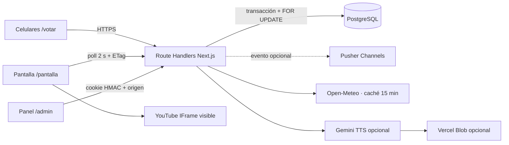

# Arquitectura

PostgreSQL es la única autoridad. `radio_state` es singleton; cada cierre bloquea la fila, usa `now()` de la BD, resuelve votos, encola la ganadora e incrementa versión/ETag. No hay timers persistentes, servidor WebSocket propio, estado global fiable ni escritura runtime a disco.

Sin Pusher se mantiene polling; sin Gemini/Blob se muestra texto y usa `speechSynthesis`; sin BD las páginas renderizan y muestran error, y APIs responden 503.

Pendiente: reportar eventos reales del IFrame; CRUD completo de catálogo/reglas/eventos; restauración web; prueba concurrente PostgreSQL.
